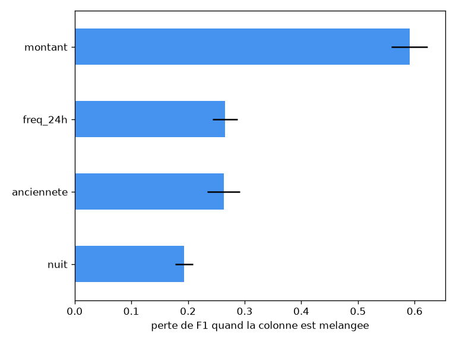
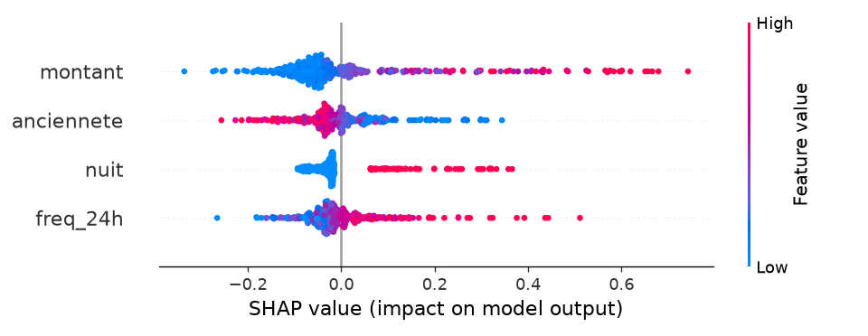
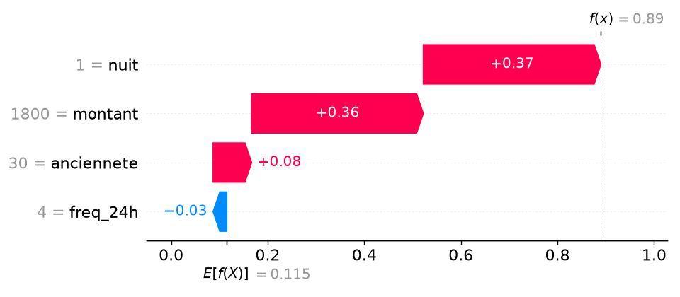
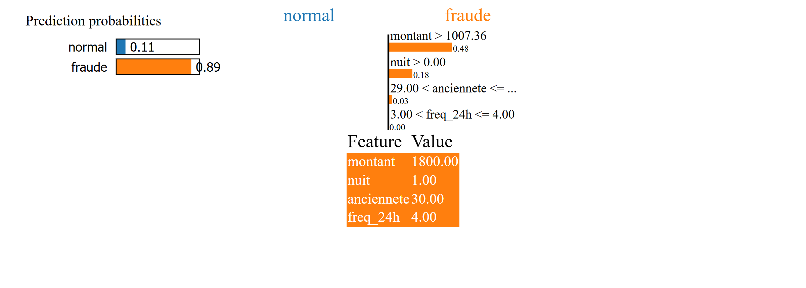
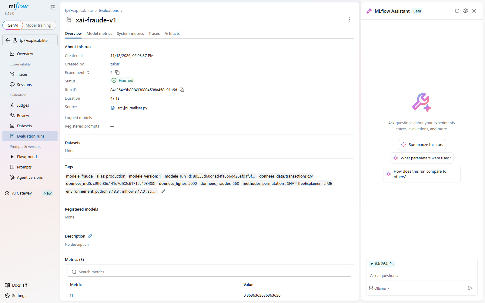
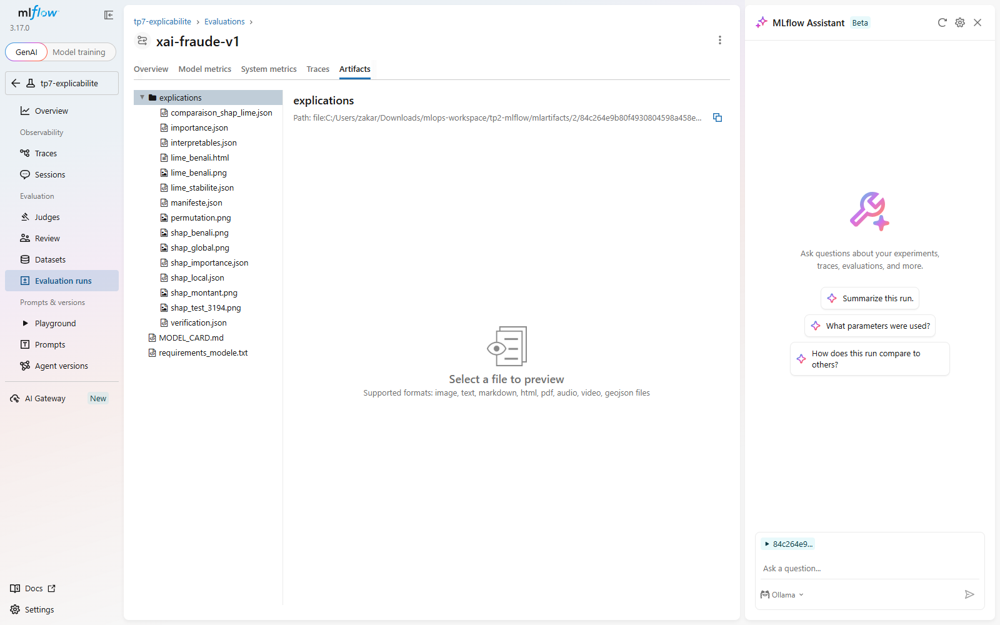
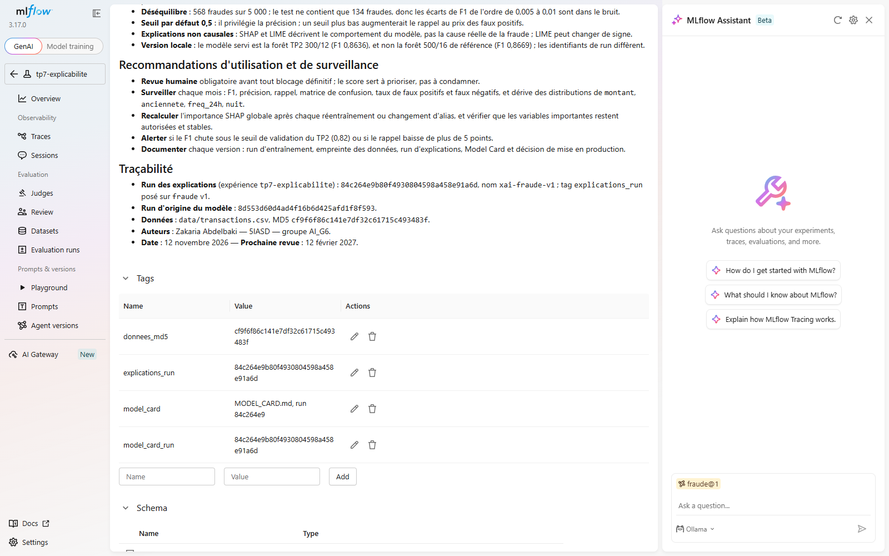

# Rapport TP07 — Explicabilité et auditabilité du modèle de fraude

**Étudiant :** Zakaria Abdelbaki  
**Filière :** 5IASD — Groupe AI_G6 — EMSI  
**Cours :** Déploiement d'IA (2026-2027)  
**Date :** 12 novembre 2026  
**Projet :** `tp7-xai`  
**Modèle expliqué :** `fraude`, version 1, alias `production`

---

## 1. Introduction

Ce TP prolonge le TP2 : le modèle de détection de fraude est déjà entraîné et servi par le registre MLflow, mais il reste une boîte noire. L'objectif est de l'expliquer globalement (quelles variables comptent), localement (pourquoi Mme Benali est signalée), de comparer SHAP et LIME, de mesurer le coût d'un modèle intrinsèquement interprétable, puis de rendre toute la chaîne auditable : données, run d'entraînement, version du modèle, explications et Model Card.

Le fil conducteur est celui du cours : **données → modèle → explications → documentation et audit**. Une explication n'a de valeur d'audit que si l'on sait à quel modèle, à quelle version et à quelles données elle se rapporte.

---

## 2. Environnement et adaptation du registre TP2

### 2.1 Versions utilisées

| Composant | Version |
|---|---|
| Python | 3.13.3 |
| MLflow | 3.17.0 |
| scikit-learn | 1.9.1 |
| pandas | 3.0.6 |
| numpy | 2.5.3 |
| scipy | 1.18.1 |
| skops | 0.16.0 |
| SHAP | 0.54.1 |
| LIME | 0.2.0.1 |
| matplotlib | 3.11.2 |

Les versions du modèle ont été lues dans `requirements_modele.txt`, lui-même extrait avec `mlflow.pyfunc.get_model_dependencies('models:/fraude@production')`, conformément au sujet. Le fichier contient :

```text
mlflow==3.17.0
numpy==2.5.3
pandas==3.0.6
scikit-learn==1.9.1
scipy==1.18.1
skops==0.16.0
```

### 2.2 Registre trouvé et adaptation documentée

Le registre du TP2 a bien été retrouvé sur le poste :

```text
C:\Users\zakar\Downloads\mlops-workspace\tp2-mlflow\mlflow.db
C:\Users\zakar\Downloads\mlops-workspace\tp2-mlflow\mlartifacts\
C:\Users\zakar\Downloads\mlops-workspace\tp2-mlflow\data\transactions.csv
```

Il n'a **pas** été reconstruit avec l'Annexe A. En revanche, le modèle TP2 local n'était pas enregistré sous le nom `fraude` : il s'appelait **`fraude-tp2`**, version 2, sans alias. Ses caractéristiques sont :

- `RandomForestClassifier` ;
- **300 arbres**, profondeur maximale **12**, `random_state=42` ;
- run d'origine : `8d553d60d4ad4f16b6d425afd1f8f593` ;
- F1 enregistré : **0,8636**.

Pour respecter le nom et l'alias demandés par le sujet sans réentraîner ni remplacer le travail du TP2, le script `src/preparer_modele_fraude.py` a enregistré **le même modèle** (même source, même run) sous le nom `fraude`, version 1, puis a posé l'alias `production`. Cette adaptation est volontairement visible dans la Model Card et dans le rapport.

> **Conséquence importante :** les valeurs de référence du PDF (forêt 500/16, F1 0,8669, P(Mme Benali)=0,924, transaction de test n° 668) ne sont pas recopiées. Les résultats ci-dessous sont ceux de la version réellement servie dans le registre local : forêt 300/12, F1 0,8636, P(Mme Benali)=0,8899, transaction la plus suspecte n° 3194. Le sujet prévoit explicitement ce cas : « Si l'alias production pointe sur une autre version dans votre registre, vos chiffres seront ceux de cette version : relevez-les, ils serviront de référence. »

### 2.3 Lancement du serveur MLflow

Le serveur du TP2 est lancé dans un premier terminal PowerShell :

```powershell
cd C:\Users\zakar\Downloads\mlops-workspace\tp2-mlflow
.venv\Scripts\Activate.ps1
mlflow server --host 127.0.0.1 --port 5000 `
  --backend-store-uri sqlite:///mlflow.db `
  --default-artifact-root ./mlartifacts
```

Le travail TP07 se fait dans un second terminal, depuis `tp7-xai`. La variable `PYTHONUTF8=1` évite l'erreur d'encodage cp1252 provoquée par l'emoji affiché par MLflow 3 en fin de run :

```powershell
cd tp7-xai
.venv\Scripts\Activate.ps1
$env:PYTHONUTF8 = "1"
```

---

## 3. Activité 1 — Environnement et chargement du modèle

### 3.1 Ce qui a été réalisé

- Création du projet `tp7-xai`, de l'environnement `.venv` et des dossiers `data/`, `src/`, `reports/`.
- Copie de `transactions.csv` depuis le TP2.
- Extraction de `requirements_modele.txt` depuis le modèle MLflow.
- Implémentation de `src/xai_commun.py` : chargement par `models:/fraude@production`, découpage `test_size=0.25`, `random_state=42`, définition de la transaction de Mme Benali.
- Implémentation et exécution de `src/verifier_modele.py`.

### 3.2 Sortie réelle de `src/verifier_modele.py`

```text
modele     : fraude version 1 | run 8d553d60
classe     : RandomForestClassifier | {'n_estimators': '300', 'max_depth': '12'}
F1         : 0.8636 | F1 enregistre dans le run : 0.8636
precision  : 0.8769 | rappel : 0.8507 | AUC : 0.9884
matrice    : [[1100, 16], [20, 114]]
Mme Benali : P(fraude) = 0.8899
verification ecrite dans reports/verification.json
```

### 3.3 Lecture des résultats

- Le modèle chargé est bien un `RandomForestClassifier` de **300 arbres** et profondeur **12**.
- Le F1 recalculé sur le jeu de test (0,8636) est identique au F1 enregistré dans le run : le découpage et les données sont cohérents.
- La matrice de confusion contient **16 faux positifs** et **20 faux négatifs** : le modèle détecte 114 fraudes sur 134, mais laisse passer 20 fraudes et bloque 16 transactions normales.
- Mme Benali obtient une probabilité de fraude de **0,8899**, soit environ 89 %.
- L'AUC de 0,9884 indique une très bonne séparation globale, mais l'AUC ne dit rien sur le seuil de décision ni sur les cas individuels.

### 3.4 Capture 1

**Capture 1a — sortie terminal réelle** : voir le bloc de code ci-dessus (copie fidèle de l'exécution).

**Capture 1b — onglet Model Registry de MLflow** : la version `fraude` v1, l'alias `production`, la provenance `fraude-tp2` v2 et le début de la Model Card.


---

## 4. Activité 2 — Explicabilité globale

### 4.1 Importance MDI et importance par permutation

Le script `src/xai_importance.py` calcule :

- la **MDI** (`feature_importances_`), calculée par la forêt sur les données d'entraînement ;
- l'**importance par permutation** sur le jeu de test, avec 10 répétitions et `random_state=0` : on mélange une colonne à la fois et on mesure la perte de F1.

Tableau réel obtenu (`reports/importance.json`) :

| Variable | MDI (forêt) | Permutation | Écart-type |
|---|---:|---:|---:|
| montant | 0,480 | 0,591 | 0,032 |
| freq_24h | 0,191 | 0,265 | 0,022 |
| anciennete | 0,236 | 0,263 | 0,029 |
| nuit | 0,093 | 0,193 | 0,016 |

Le classement par permutation est : **montant (0,591) > freq_24h (0,265) > anciennete (0,263) > nuit (0,193)**. Le classement MDI est : **montant (0,480) > anciennete (0,236) > freq_24h (0,191) > nuit (0,093)**.

### 4.2 SHAP global

Le script `src/xai_global.py` utilise `shap.TreeExplainer`, exact pour les forêts, sur un échantillon de **400 transactions de test** (`random_state=0`). La sortie SHAP a trois dimensions `(transaction, variable, classe)` ; on garde la classe **1 = fraude**.

Valeur de base réelle : **0,1153** (probabilité moyenne de fraude prédite par le modèle sur l'échantillon).

| Variable | Importance SHAP moyenne \|valeur\| |
|---|---:|
| montant | 0,1155 |
| anciennete | 0,0578 |
| nuit | 0,0572 |
| freq_24h | 0,0555 |

### 4.3 Lecture et différences entre les trois méthodes

- **Le montant domine** les trois méthodes. C'est la variable la plus utilisée par la forêt (MDI), celle dont le mélange fait le plus chuter le F1 (permutation) et celle dont la contribution absolue moyenne est la plus forte (SHAP).
- **La MDI et la permutation ne donnent pas exactement le même classement.** La MDI place `anciennete` devant `freq_24h`, la permutation fait l'inverse. L'écart permutation entre `freq_24h` (0,265) et `anciennete` (0,263) vaut 0,002, très inférieur aux écarts-types (0,022 et 0,029) : cet ordre n'est pas robuste. Il ne faut donc pas surinterpréter la deuxième place.
- **Le cas de `nuit` est le plus instructif** : MDI = 0,093, permutation = 0,193. La MDI mesure la baisse d'impureté **sur l'entraînement** ; elle favorise les variables qui coupent souvent et haut dans les arbres. `nuit` est binaire et utilisée dans moins de splits, donc sa MDI est faible. La permutation mesure la **dépendance du F1 de test** à la colonne : mélanger `nuit` détruit un signal fort (paiement de nuit), ce qui fait perdre 0,193 de F1 en moyenne. La permutation est donc plus proche de l'usage réel, mais elle dépend du jeu de test et des corrélations entre variables.
- **SHAP** apporte en plus le **sens** et la **forme** de l'effet, ce que la permutation ne donne pas.

### 4.4 Capture 2

**Capture 2a — tableau de permutation** (graphique réel `reports/permutation.png`) :



**Capture 2b — beeswarm SHAP global** (`reports/shap_global.png`) :



Le graphique `reports/shap_montant.png` montre la contribution SHAP du montant en fonction du montant, colorée par `nuit` : la contribution devient positive à partir d'environ **1 000 MAD**, puis augmente fortement avec le montant.

---

## 5. Activité 3 — Explicabilité locale SHAP

### 5.1 Transaction de Mme Benali

Transaction : `montant = 1 800 MAD`, `anciennete = 30 mois`, `freq_24h = 4`, `nuit = 1`.

Sortie réelle de `src/xai_local.py` :

```text
--- benali : {'montant': 1800.0, 'anciennete': 30.0, 'freq_24h': 4.0, 'nuit': 1.0}
valeur de base : 0.1153
  nuit        +0.3677
  montant     +0.3555
  anciennete  +0.0798
  freq_24h    -0.0284
base + somme   : 0.8899 | prediction : 0.8899 | ecart : 3.30e-14
```

### 5.2 Transaction de test la plus suspecte

La transaction de test la plus suspecte de notre modèle est l'index **3194** (et non 668, qui correspond à la forêt 500/16 de référence) :

```text
--- test_3194 : {'montant': 8806.06, 'anciennete': 14.0, 'freq_24h': 7.0, 'nuit': 0.0}
valeur de base : 0.1153
  montant     +0.6568
  anciennete  +0.1459
  freq_24h    +0.1131
  nuit        -0.0316
base + somme   : 0.9995 | prediction : 0.9995 | ecart : 7.77e-16
```

### 5.3 Vérification de la propriété d'efficacité

Pour Mme Benali :

```text
0,1153 + 0,3677 + 0,3555 + 0,0798 - 0,0284 = 0,8899
```

Pour la transaction 3194 :

```text
0,1153 + 0,6568 + 0,1459 + 0,1131 - 0,0316 = 0,9995
```

Dans les deux cas, `valeur de base + somme des contributions SHAP = prédiction`, à la précision machine près (écarts de l'ordre de 10⁻¹⁴ et 10⁻¹⁶). C'est la propriété d'efficacité des valeurs de Shapley : elle rend l'explication **vérifiable numériquement**, ce que LIME ne garantit pas.

### 5.4 Phrase destinée à Mme Benali

> **« Madame Benali, votre paiement de 1 800 MAD a été signalé parce qu'il a été effectué de nuit et que son montant est nettement plus élevé que vos paiements habituels. Le modèle estime le risque à environ 89 %, mais un conseiller va vérifier l'opération avec vous avant toute décision. »**

Cette phrase ne dit pas « le modèle a raison » ni « vous avez fraudé » : elle explique les deux facteurs qui ont fait monter le score et rappelle la revue humaine.

### 5.5 Pourquoi `nuit` est positive pour Mme Benali et négative pour la transaction 3194

- Pour Mme Benali, `nuit = 1` : le paiement a lieu entre 0 h et 5 h, un signal que la forêt associe à la fraude. La contribution est **+0,3677**.
- Pour la transaction 3194, `nuit = 0` : l'absence de paiement de nuit est un facteur **légèrement protecteur** par rapport à la valeur de base, d'où **−0,0316**. Cela ne veut pas dire que « la nuit protège » en général ; cela signifie que, pour cette transaction, le fait de ne pas être un paiement nocturne réduit un peu le score. Les autres contributions (montant +0,6568, anciennete +0,1459, freq_24h +0,1131) dominent largement et expliquent la prédiction finale de 0,9995.

### 5.6 Capture 3

**Capture 3a — sortie terminal réelle** : voir les blocs de code ci-dessus.

**Capture 3b — waterfall SHAP de Mme Benali** (`reports/shap_benali.png`) :



Le waterfall se lit de bas en haut : on part de `E[f(X)] = 0,115`, chaque barre rouge pousse vers la fraude, chaque barre bleue vers « normal », et on arrive à `f(x) = 0,89`.

---

## 6. Activité 4 — Explicabilité locale LIME

### 6.1 Principe et explication de référence

LIME est **agnostique** : il n'utilise que `m.predict_proba`, ignore la structure de la forêt et apprend un modèle linéaire local autour de la transaction. Les seuils des règles (par exemple `montant > 1007.36`) sont les quartiles des données d'entraînement ; ils sont identiques pour toutes les graines.

Explication de référence (`n = 2000` voisins, graine 0) :

```text
regles : [('montant > 1007.36', 0.483),
          ('nuit > 0.00', 0.182),
          ('29.00 < anciennete <= 60.00', 0.026),
          ('3.00 < freq_24h <= 4.00', 0.001)]
```

La page interactive est dans `reports/lime_benali.html` et le graphique dans `reports/lime_benali.png`.

### 6.2 Stabilité sur 5 graines et deux tailles de voisinage

Tableau complet des poids LIME réellement calculés :

| Voisins | Graine | montant | nuit | anciennete | freq_24h |
|---:|---:|---:|---:|---:|---:|
| 500 | 0 | +0,459 | +0,244 | −0,007 | −0,035 |
| 500 | 1 | +0,499 | +0,245 | +0,060 | −0,018 |
| 500 | 2 | +0,406 | +0,208 | +0,002 | −0,021 |
| 500 | 3 | +0,384 | +0,192 | +0,015 | −0,028 |
| 500 | 4 | +0,479 | +0,189 | −0,005 | −0,035 |
| 2 000 | 0 | +0,483 | +0,182 | +0,026 | +0,001 |
| 2 000 | 1 | +0,429 | +0,236 | +0,032 | −0,037 |
| 2 000 | 2 | +0,440 | +0,180 | +0,025 | +0,012 |
| 2 000 | 3 | +0,455 | +0,205 | +0,020 | −0,016 |
| 2 000 | 4 | +0,455 | +0,228 | +0,034 | −0,003 |

Statistiques (moyenne ± écart-type, minimum–maximum) :

| Voisins | Variable | Moyenne ± écart-type | Min–max | Changements de signe | Signe stable ? |
|---:|---|---:|---:|---:|---|
| 500 | montant | +0,446 ± 0,044 | +0,384 à +0,499 | 0 | Oui |
| 500 | nuit | +0,216 ± 0,024 | +0,189 à +0,245 | 0 | Oui |
| 500 | anciennete | +0,013 ± 0,025 | −0,007 à +0,060 | 2 | **Non** |
| 500 | freq_24h | −0,028 ± 0,007 | −0,035 à −0,018 | 0 | Oui (négatif) |
| 2 000 | montant | +0,453 ± 0,018 | +0,429 à +0,483 | 0 | Oui |
| 2 000 | nuit | +0,206 ± 0,023 | +0,180 à +0,236 | 0 | Oui |
| 2 000 | anciennete | +0,028 ± 0,005 | +0,020 à +0,034 | 0 | Oui (positif) |
| 2 000 | freq_24h | −0,009 ± 0,017 | −0,037 à +0,012 | 3 | **Non** |

### 6.3 Tableau comparatif SHAP / LIME demandé

| Variable | SHAP (activité 3) | LIME, 2 000 voisins, graine 0 | Stable sur 5 graines ? |
|---|---:|---:|---|
| montant | +0,3555 | +0,4834 | **Oui** : positif aux deux tailles (500 : +0,384 à +0,499 ; 2 000 : +0,429 à +0,483) |
| nuit | +0,3677 | +0,1821 | **Oui** : positif aux deux tailles (500 : +0,189 à +0,245 ; 2 000 : +0,180 à +0,236) |
| anciennete | +0,0798 | +0,0262 | **Non à 500** (2 changements de signe, −0,007 à +0,060) ; oui à 2 000 (+0,020 à +0,034), mais poids faible |
| freq_24h | −0,0284 | +0,0009 | **Non à 2 000** (3 changements de signe, −0,037 à +0,012) ; oui négatif à 500 (−0,035 à −0,018) |

### 6.4 Analyse de stabilité

- **`montant` et `nuit` sont les deux seules contributions réellement stables et importantes.** Leur signe ne change jamais et leur amplitude reste du même ordre.
- **`anciennete` est instable à 500 voisins** : elle passe de −0,007 à +0,060 puis revient près de zéro. À 2 000 voisins, elle devient positive et stable, mais son poids (0,020 à 0,034) est faible devant `montant` et `nuit`. On peut donc la mentionner comme facteur secondaire, pas comme cause principale.
- **`freq_24h` est instable à 2 000 voisins** : +0,001, −0,037, +0,012, −0,016, −0,003. Trois changements de signe. À 500 voisins, elle est négative de façon stable, mais avec un poids très faible. Cette variable ne doit pas être présentée à une cliente comme une cause.
- **Règle avant de communiquer une explication à un client :** fixer la graine et la taille du voisinage (ici 2 000), répéter l'explication sur au moins 5 graines, ne communiquer que les variables dont le **signe est identique sur les 5 graines** et dont la **valeur absolue reste supérieure à 0,05**. Dans notre cas, seuls `montant` et `nuit` passent ce filtre. Les autres facteurs peuvent être regroupés en « autres éléments pris en compte » sans les détailler.

### 6.5 Capture 4

**Capture 4a — sortie terminal réelle** : voir le tableau complet ci-dessus.

**Capture 4b — page HTML interactive LIME** (`reports/lime_benali.html`) :



La page affiche les probabilités prédites (normal 0,11 ; fraude 0,89), les règles et leurs poids, ainsi que les valeurs des quatre variables.

---

## 7. Activité 5 — Modèles interprétables

### 7.1 Tableau du compromis performance / interprétabilité

Tous les modèles sont évalués sur le **même jeu de test** de 1 250 transactions, dont 134 fraudes.

| Modèle | F1 | Fraudes détectées | Ce que l'on peut expliquer sans outil |
|---|---:|---:|---|
| Forêt `fraude@production` (300 arbres, profondeur 12) | **0,8636** | **114 / 134** | Rien directement : il faut SHAP ou LIME |
| Régression logistique, montant brut | 0,7407 | 90 / 134 | Coefficients et odds ratios, mais le montant brut est mal modélisé |
| Régression logistique, `log10(montant)` | 0,8593 | 113 / 134 | Coefficients et odds ratios, très lisible |
| Arbre de profondeur 2 (4 feuilles) | 0,2293 | 18 / 134 | 4 règles très courtes, mais performance très faible |
| Arbre de profondeur 3 (8 feuilles) | 0,5737 | 72 / 134 | 8 feuilles, règles lisibles, mais 42 fraudes manquées |
| Arbre de profondeur 6 (50 feuilles) | 0,7510 | 95 / 134 | 50 feuilles, lisible mais déjà volumineux |
| Arbre sans limite (206 feuilles) | 0,7556 | 102 / 134 | 206 feuilles : illisible en pratique |

Précisions utiles pour la question 8 :

- Forêt : précision **0,8769**, rappel **0,8507**, matrice `[[1100, 16], [20, 114]]`.
- Logistique `log10(montant)` : précision **0,8760**, rappel **0,8433**, matrice `[[1100, 16], [21, 113]]`.

La forêt et la logistique `log10` ont **le même nombre de faux positifs (16)** ; la forêt détecte **une fraude de plus** (114 contre 113) et a un faux négatif de moins (20 contre 21).

### 7.2 Coefficients de la régression logistique

Coefficients standardisés réels :

```text
{'anciennete': -2.58, 'freq_24h': 2.75, 'nuit': 2.23, 'log_montant': 4.93}
```

Interprétation :

- `log_montant` a le coefficient positif le plus fort (+4,93) : plus le montant est élevé en ordre de grandeur, plus le risque augmente.
- `freq_24h` (+2,75) et `nuit` (+2,23) augmentent le risque.
- `anciennete` (−2,58) le diminue : les clients plus anciens sont moins risqués.
- Les cotes (odds ratios) calculées par le script : **×0,928 par mois d'ancienneté** et **×4,76 par transaction supplémentaire en 24 h**. Autrement dit, chaque mois d'ancienneté multiplie la cote de fraude par 0,928 (effet protecteur), et chaque transaction de plus sur 24 h la multiplie par 4,76 (effet aggravant).

### 7.3 Arbre de profondeur 3 : règles

Arbre réel (`reports/arbre_profondeur3.txt`) :

```text
|--- montant <= 1505.7
|   |--- freq_24h <= 6.5
|   |   |--- nuit <= 0.5
|   |   |   |--- class: 0
|   |   |--- nuit >  0.5
|   |   |   |--- class: 0
|   |--- freq_24h >  6.5
|   |   |--- montant <= 371.9
|   |   |   |--- class: 0
|   |   |--- montant >  371.9
|   |   |   |--- class: 0
|--- montant >  1505.7
|   |--- nuit <= 0.5
|   |   |--- anciennete <= 69.5
|   |   |   |--- class: 1
|   |   |--- anciennete >  69.5
|   |   |   |--- class: 0
|   |--- nuit >  0.5
|   |   |--- anciennete <= 64.0
|   |   |   |--- class: 1
|   |   |--- anciennete >  64.0
|   |   |   |--- class: 1
```

Lecture simplifiée en règles « SI … ALORS fraude » :

- **R1 :** SI `montant > 1505,7` ET `nuit = 0` ET `anciennete <= 69,5` ALORS fraude.
- **R2 :** SI `montant > 1505,7` ET `nuit = 1` ALORS fraude (quel que soit l'âge ; l'arbre sépare à 64 mois mais les deux feuilles sont fraudes).
- **R3 :** SI `montant <= 1505,7` ALORS normal (toutes les feuilles de cette branche sont classe 0).
- **R4 :** SI `montant > 1505,7` ET `nuit = 0` ET `anciennete > 69,5` ALORS normal.

On peut résumer : **fraise si `montant > 1505,7` ET (`nuit = 1` OU `anciennete <= 69,5`)**. C'est une règle courte, lisible, mais elle ne détecte que 72 fraudes sur 134.

### 7.4 Chemin de Mme Benali dans l'arbre de profondeur 3

Chemin réel (nœuds 0 → 8 → 12 → 13) :

| Nœud | Condition | Valeur de Mme Benali | Direction |
|---:|---|---:|---|
| 0 | `montant <= 1505,68` ? | 1 800 | Non → droite (nœud 8) |
| 8 | `nuit <= 0,5` ? | 1 | Non → droite (nœud 12) |
| 12 | `anciennete <= 64,0` ? | 30 | Oui → gauche (feuille 13) |
| 13 | feuille | — | **P(fraude) = 0,983** |

Mme Benali est donc dans la **feuille 13**, avec une probabilité de fraude de **0,983** selon l'arbre de profondeur 3. C'est cohérent avec la forêt (0,8899) et avec SHAP (nuit et montant en tête).

### 7.5 Compromis

- La forêt est la plus performante (F1 0,8636, 114 fraudes), mais elle n'est pas lisible directement.
- La logistique `log10(montant)` est presque aussi performante (F1 0,8593, 113 fraudes, mêmes 16 faux positifs) et **intrinsèquement lisible** : coefficients, odds ratios, sens des effets.
- L'arbre de profondeur 3 est le plus lisible, mais il perd **42 fraudes** (72/134) : son F1 de 0,5737 est trop faible pour un blocage automatique.
- L'arbre sans limite retrouve 102 fraudes mais devient illisible (206 feuilles) : il n'apporte pas le compromis recherché.
- **Conclusion du compromis :** plus le modèle est lisible, plus il perd en performance ; la logistique `log10` est le meilleur compromis si l'on exige un modèle intrinsèquement explicable, la forêt + SHAP restant le choix de performance.

---

## 8. Activité 6 — Traçabilité et auditabilité MLflow

### 8.1 Run d'explications

Le script `src/journaliser.py` crée l'expérience **`tp7-explicabilite`** et le run **`xai-fraude-v1`**.

- **Run ID :** `84c264e9b80f4930804598a458e91a6d`
- **Statut :** `FINISHED`
- **Tags :**
  - `modele = fraude`
  - `alias = production`
  - `modele_version = 1`
  - `modele_run_id = 8d553d60d4ad4f16b6d425afd1f8f593`
  - `donnees = data/transactions.csv`
  - `donnees_md5 = cf9f6f86c141e7df32c61715c493483f`
  - `donnees_lignes = 5000`
  - `donnees_fraudes = 568`
  - `methodes = permutation ; SHAP TreeExplainer ; LIME`
  - `environnement = python 3.13.3 ; mlflow 3.17.0 ; scikit-learn 1.9.1`
- **Paramètres :** `shap_echantillon = 400`, `lime_num_samples = 2000`, `lime_random_state = 0`, `permutation_n_repeats = 10`.
- **Métriques :** F1 = 0,863636…, précision = 0,876923…, rappel = 0,850746….

### 8.2 Artefacts archivés

Le dossier `explications/` contient **15 fichiers** :

```text
comparaison_shap_lime.json
importance.json
interpretables.json
lime_benali.html
lime_benali.png
lime_stabilite.json
manifeste.json
permutation.png
shap_benali.png
shap_global.png
shap_importance.json
shap_local.json
shap_montant.png
shap_test_3194.png
verification.json
```

Le run contient aussi `MODEL_CARD.md` et `requirements_modele.txt` à la racine de ses artefacts.

### 8.3 Lien avec la version du modèle

Les tags posés sur la version `fraude` v1 sont :

| Tag | Valeur |
|---|---|
| `explications_run` | `84c264e9b80f4930804598a458e91a6d` |
| `donnees_md5` | `cf9f6f86c141e7df32c61715c493483f` |
| `model_card` | `MODEL_CARD.md, run 84c264e9` |
| `model_card_run` | `84c264e9b80f4930804598a458e91a6d` |

Ainsi, un auditeur qui part de la version du modèle trouve immédiatement le run d'explications, l'empreinte des données et la Model Card. Inversement, le run d'explications porte `modele_version` et `modele_run_id`, ce qui permet de revenir à la version exacte et au run d'entraînement.

### 8.4 Capture 5

**Capture 5a — vue d'ensemble du run `xai-fraude-v1`** (métriques, paramètres, tags) :



**Capture 5b — dossier `explications/` du run** :



---

## 9. Activité 7 — Model Card

### 9.1 Rédaction

La Model Card complète est à la racine du projet : `MODEL_CARD.md`. Elle contient les rubriques demandées : identification et version, objectif et usage prévu, usages exclus, données, performances, méthodes d'explicabilité, comparaison avec les modèles interprétables, limites et risques, recommandations de surveillance, traçabilité.

Son contenu intégral est repris en annexe A.

### 9.2 Publication dans MLflow

Le script `src/publier_card.py` :

- rouvre le run d'explications `84c264e9…` ;
- y attache `MODEL_CARD.md` ;
- met la Model Card dans la **description** de la version `fraude` v1 ;
- pose les tags `model_card` et `model_card_run`.

Sortie réelle :

```text
Model Card attachee a fraude v1 et au run 84c264e9
description commence par : # Model Card — fraude (version servie par l'alias `production`)
tag model_card : MODEL_CARD.md, run 84c264e9
MODEL_CARD.md dans le run : True
```

### 9.3 Capture 6

**Capture 6 — page de la version `fraude` v1 : description et tags** :



La capture 1 montre le haut de la même page (alias `production`, provenance, début de la Model Card) ; la capture 6 montre les tags `donnees_md5`, `explications_run`, `model_card` et `model_card_run`.

---

## 10. Réponses aux 10 questions

### Question 1 — Le registre et l'alias

**Pourquoi charger par `models:/fraude@production` plutôt que par un fichier ou un numéro de version ?**

Parce que l'alias est un **pointeur stable** vers la version actuellement servie. Le code ne dépend ni d'un chemin de fichier local ni d'un numéro de version codé en dur : si la version 2 est promue en production, l'alias est déplacé et le même appel charge la nouvelle version. Cela évite les erreurs du type « on explique un modèle, mais c'est un autre qui est servi ». Le registre garantit aussi que l'on récupère l'objet scikit-learn d'origine, nécessaire à SHAP.

**Si l'alias était déplacé vers la version 2, que deviendraient les explications de l'activité 6, et comment le saurait-on ?**

Les explications de l'activité 6 resteraient attachées à la **version 1** : le run `84c264e9…` porte `modele_version = 1` et `modele_run_id = 8d553d60…`, et la version 1 porte le tag `explications_run = 84c264e9…`. La version 2 n'aurait pas ces tags. Un auditeur le verrait en comparant `modele_version` du run et le tag `explications_run` de la version. Si l'on relançait le pipeline après le déplacement de l'alias, il chargerait la version 2 et créerait un **nouveau** run d'explications avec `modele_version = 2` ; les deux runs seraient distincts et traçables. Les anciennes explications ne seraient pas perdues, mais elles ne s'appliqueraient plus au modèle servi : il faudrait les archiver comme « explications de la v1 » et produire celles de la v2.

### Question 2 — Deux importances globales

**La MDI et la permutation donnent-elles le même classement ?**

Non, pas exactement. Nos résultats :

- MDI : `montant` 0,480 > `anciennete` 0,236 > `freq_24h` 0,191 > `nuit` 0,093.
- Permutation : `montant` 0,591 > `freq_24h` 0,265 > `anciennete` 0,263 > `nuit` 0,193.

Le haut (`montant`) et le bas (`nuit`) sont les mêmes, mais `anciennete` et `freq_24h` sont inversés. L'écart permutation entre les deux (0,265 contre 0,263) est de 0,002, très inférieur aux écarts-types (0,022 et 0,029) : cet ordre n'est pas robuste.

**Expliquez la différence observée sur `nuit` (0,093 contre 0,193) à partir de la façon dont chacune est calculée.**

La **MDI** est calculée pendant l'entraînement : elle mesure la baisse moyenne d'impureté (Gini) apportée par les splits sur cette variable. Elle favorise les variables qui coupent souvent et haut dans les arbres ; `nuit` est binaire et utilisée dans moins de splits, donc sa MDI est faible (0,093). La **permutation** est calculée sur le jeu de test : on mélange la colonne `nuit` et on mesure la perte de F1. Mélanger `nuit` détruit un signal fort (les paiements de nuit sont surreprésentés dans les fraudes), ce qui fait perdre 0,193 de F1 en moyenne. La permutation mesure donc la **dépendance du modèle à la variable pour la performance de test**, pas la fréquence d'utilisation dans les arbres. C'est pourquoi `nuit` est sous-estimée par la MDI.

### Question 3 — Lire le beeswarm

**Dans votre graphique SHAP global, dans quel sens agit l'ancienneté ?**

Dans le beeswarm, les points **rouges** (ancienneté élevée) sont à **gauche** de zéro (contributions négatives) et les points **bleus** (ancienneté faible) à **droite** (contributions positives). Autrement dit, **plus un client est ancien, plus le modèle réduit son risque de fraude ; plus son compte est récent, plus le risque augmente**. C'est cohérent avec le coefficient négatif de l'ancienneté dans la régression logistique (−2,58) et avec l'odds ratio de 0,928 par mois.

**Qu'apporte ce graphique que la permutation ne dit pas ?**

La permutation donne une **importance scalaire** (une perte moyenne de F1), sans signe ni forme. Le beeswarm montre :

- le **signe** de l'effet (positif ou négatif) ;
- la **distribution** des contributions, pas seulement la moyenne ;
- la **forme** de l'effet : pour `montant`, la contribution devient positive vers 1 000 MAD puis augmente ; pour `nuit`, l'effet est binaire (deux nuages) ; pour `anciennete`, l'effet est progressif ;
- l'**hétérogénéité** : deux transactions de même ancienneté peuvent avoir des contributions différentes selon les autres variables.

La permutation répond à « quelle variable compte en moyenne ? » ; le beeswarm répond à « dans quel sens et pour quels types de transactions ? ».

### Question 4 — Global et local

**Pour Mme Benali, `nuit` est la première cause du blocage ; dans l'importance SHAP globale, elle n'est que troisième. Est-ce une contradiction ?**

Non. L'importance globale est la **moyenne des valeurs absolues** des contributions sur 400 transactions : `nuit` = 0,0572, juste derrière `anciennete` (0,0578) et loin derrière `montant` (0,1155). Cette moyenne dilue les cas où `nuit = 1`, qui sont minoritaires (environ 18 % des transactions). Localement, pour Mme Benali, `nuit = 1` et son effet est fort : **+0,3677**, devant `montant` (+0,3555). Une variable peut donc être globalement moyenne et localement décisive. C'est exactement la différence entre **importance moyenne** et **contribution locale**.

**Vérifiez la propriété d'efficacité sur vos chiffres.**

Pour Mme Benali :

```text
0,1153 (base) + 0,3677 (nuit) + 0,3555 (montant) + 0,0798 (anciennete) − 0,0284 (freq_24h)
= 0,8899 = prédiction
```

L'écart numérique est de **3,30 × 10⁻¹⁴**. Pour la transaction 3194 :

```text
0,1153 + 0,6568 + 0,1459 + 0,1131 − 0,0316 = 0,9995 = prédiction
```

L'écart est de **7,77 × 10⁻¹⁶**. La propriété d'efficacité est donc vérifiée à la précision machine, pour les deux explications locales.

### Question 5 — La phrase pour la cliente

**Phrase destinée à Mme Benali :**

> **« Madame Benali, votre paiement de 1 800 MAD a été signalé parce qu'il a été effectué de nuit et que son montant est nettement plus élevé que vos paiements habituels. Le modèle estime le risque à environ 89 %, mais un conseiller va vérifier l'opération avec vous avant toute décision. »**

**Pour la transaction 3194, `nuit` a une contribution négative : pourquoi ?**

Parce que `nuit = 0` : la transaction n'est pas un paiement nocturne. Par rapport à la valeur de base (0,1153), l'absence de ce signal de risque **réduit légèrement** le score, d'où −0,0316. Ce n'est pas une contradiction avec le cas de Mme Benali : pour elle, `nuit = 1` et le signal est positif (+0,3677). La contribution SHAP est **relative à la valeur de base et aux autres variables** ; elle ne dit pas que « la nuit protège » dans l'absolu. Pour la transaction 3194, les contributions positives du montant (+0,6568), de l'ancienneté (+0,1459) et de la fréquence (+0,1131) dominent largement la petite contribution négative de `nuit`, et la prédiction finale est 0,9995.

### Question 6 — La stabilité de LIME

**Quelles contributions restent stables sur les cinq graines, lesquelles changent de signe ?**

- **Stables et positives :** `montant` (500 : +0,384 à +0,499 ; 2 000 : +0,429 à +0,483) et `nuit` (500 : +0,189 à +0,245 ; 2 000 : +0,180 à +0,236). Aucun changement de signe.
- **`anciennete` :** change de signe à 500 voisins (2 changements, de −0,007 à +0,060) ; devient positive et stable à 2 000 voisins (+0,020 à +0,034), mais avec un poids faible.
- **`freq_24h` :** stable négative à 500 voisins (−0,035 à −0,018), mais **instable à 2 000** (3 changements de signe, de −0,037 à +0,012), avec un poids très faible.

**Quelle règle adopteriez-vous avant de communiquer une explication à un client ?**

Je fixerais la graine et la taille du voisinage (2 000), je répéterais l'explication sur au moins 5 graines, et je ne communiquerais que les variables qui remplissent **deux conditions** :

1. le **signe est identique sur les 5 graines** ;
2. la **valeur absolue reste supérieure à 0,05** (seuil de matérialité).

Dans notre cas, seuls `montant` et `nuit` passent ce filtre. `anciennete` est stable à 2 000 mais trop faible ; `freq_24h` change de signe. Je présenterais donc à Mme Benali le montant et le paiement de nuit, et je regrouperais le reste en « autres éléments pris en compte ». Je ne communiquerais jamais une valeur LIME unique sans intervalle de variation.

### Question 7 — SHAP ou LIME

**SHAP et LIME désignent-ils les mêmes causes principales pour Mme Benali ?**

Oui pour les deux premières, mais dans un ordre différent :

- SHAP : `nuit` (+0,3677) > `montant` (+0,3555) > `anciennete` (+0,0798) > `freq_24h` (−0,0284).
- LIME (2 000, graine 0) : `montant` (+0,4834) > `nuit` (+0,1821) > `anciennete` (+0,0262) > `freq_24h` (+0,0009).

Les deux méthodes pointent **le montant et la nuit** comme causes principales, avec un désaccord sur l'ordre. Elles s'accordent sur le signe de `montant`, `nuit` et `anciennete` ; elles divergent sur `freq_24h`, mais avec des valeurs très faibles (−0,0284 contre +0,0009), donc non matérielles.

**Pourquoi ne faut-il pas comparer directement leurs nombres ?**

Parce que les deux méthodes ne mesurent pas la même chose :

- Les valeurs SHAP sont des **valeurs de Shapley** : elles sont additives et vérifient `base + somme = prédiction`. Elles sont exprimées dans l'espace de la probabilité prédite (pour la classe 1) et sont **exactes** pour une forêt avec `TreeExplainer`.
- Les poids LIME sont les coefficients d'un **modèle linéaire local** ajusté sur des voisinages générés aléatoirement. Ils dépendent de la graine, du nombre de voisins, du noyau et de la discrétisation. Ils ne vérifient pas la propriété d'efficacité et ne s'additionnent pas à la prédiction de la même façon.

Comparer 0,3677 (SHAP) et 0,1821 (LIME) comme s'il s'agissait de la même unité n'a donc pas de sens. On compare les **signes**, les **classements** et la **stabilité**, pas les amplitudes.

**Laquelle choisir pour ce modèle, et pourquoi ?**

Je choisirais **SHAP** pour l'explication officielle et l'audit, car :

- le modèle est une forêt, donc `TreeExplainer` est **exact** et rapide ;
- la propriété d'efficacité est **vérifiable** (base + somme = prédiction), ce qui est un avantage décisif pour un audit ;
- les valeurs sont **stables** pour un modèle et un échantillon fixés (pas de graine aléatoire dans l'explication elle-même).

LIME reste utile comme **contre-expertise** et pour produire une explication pédagogique locale, mais son instabilité (changements de signe de `freq_24h` et `anciennete`) interdit de l'utiliser seul pour justifier une décision. La démarche retenue est donc : SHAP pour l'audit, LIME pour le contrôle de cohérence, et revue humaine pour la décision.

### Question 8 — Le compromis

**La logistique avec `log10(montant)` détecte 113 fraudes sur 134, la forêt 114. Quel modèle mettriez-vous en production pour bloquer des paiements ?**

Je mettrais la **forêt** en production pour le blocage, mais **avec revue humaine**, car :

- elle détecte **114 fraudes** contre 113 pour la logistique, soit **une fraude de plus** ;
- elle a **le même nombre de faux positifs (16)** que la logistique `log10` ;
- son F1 est légèrement supérieur (0,8636 contre 0,8593).

Cependant, l'écart est **très faible** : une fraude sur 134, soit 0,0043 de F1. Avec seulement 134 fraudes dans le jeu de test, une seule fraude change le F1 d'environ 0,007 ; l'écart est donc **dans le bruit**. La logistique `log10` est presque équivalente et beaucoup plus **lisible** : coefficients, odds ratios, sens des effets, pas besoin de SHAP pour expliquer une décision. Si la politique de l'entreprise exige un modèle **intrinsèquement explicable** (par exemple pour une décision de blocage contestable), je choisirais la logistique `log10`. Si la priorité est de maximiser la détection avec une explication post-hoc, je garde la forêt avec SHAP et revue humaine. Dans les deux cas, je ne bloque pas automatiquement : les 16 faux positifs et les 20 faux négatifs de la forêt imposent une vérification humaine.

### Question 9 — Reconstituer une décision

**Dans six mois, Mme Benali conteste. Quels éléments enregistrés dans ce TP permettent de rejouer la décision et son explication ?**

- La **version exacte du modèle** : `fraude` v1, alias `production`, run d'origine `8d553d60d4ad4f16b6d425afd1f8f593`, artefact `model.skops` et `requirements_modele.txt` (MLflow 3.17.0, scikit-learn 1.9.1, etc.).
- Les **données** : `data/transactions.csv`, 5 000 lignes, 568 fraudes, empreinte MD5 `cf9f6f86c141e7df32c61715c493483f`, découpage `test_size=0.25`, `random_state=42`.
- Le **run d'explications** : `84c264e9b80f4930804598a458e91a6d`, avec les tags `modele_version`, `modele_run_id`, `donnees_md5`, `methodes`, les paramètres (`shap_echantillon=400`, `lime_num_samples=2000`, `lime_random_state=0`, `permutation_n_repeats=10`) et les métriques.
- Les **artefacts** : `verification.json`, `shap_local.json` (transaction de Mme Benali, valeur de base, contributions, prédiction, écart d'efficacité), `shap_benali.png`, `lime_benali.html`, `lime_stabilite.json`, `comparaison_shap_lime.json`, `interpretables.json`, `MODEL_CARD.md`.
- Les **tags de la version** : `explications_run`, `donnees_md5`, `model_card`, `model_card_run`.
- La **transaction elle-même** : `xai_commun.py` définit `CAS` avec `montant=1800`, `anciennete=30`, `freq_24h=4`, `nuit=1`, et `shap_local.json` stocke ces valeurs.

**Lequel manque encore pour un audit complet ?**

Il manque plusieurs éléments propres à une décision réelle :

- l'**identifiant de transaction** et l'**horodatage** exacts, ainsi que le journal de la décision de production (score affiché, seuil appliqué, action prise) ;
- le **résultat de la revue humaine** et la décision finale (blocage confirmé ou non) ;
- le **seuil de décision** et la politique de blocage, qui ne sont pas stockés dans la version du modèle ;
- la **version Git / l'image de conteneur** exacte des scripts d'explication et du code d'entraînement (nous avons les fichiers et les versions de bibliothèques, pas un verrou complet) ;
- la **traçabilité DVC/Git des données** et les règles de gestion des données personnelles ;
- les **logs de surveillance** après mise en production (dérive, performance réelle, incidents).

Le TP fournit donc une excellente **reproductibilité au niveau du modèle et de l'explication**, mais pas encore un **audit complet de la décision métier**. C'est une limite importante à mentionner dans la Model Card.

### Question 10 — La Model Card

**Usage exclu :** « bloquer définitivement un compte ou un paiement sans revue humaine ».

**Justification par un résultat du TP :** la forêt produit **16 faux positifs** et **20 faux négatifs** sur 1 250 transactions de test. Un faux positif bloquerait à tort un client normal ; un faux négatif montre que le modèle laisse passer 20 fraudes. Une décision définitive sans revue humaine serait donc injustifiée. De plus, SHAP et LIME expliquent le modèle, pas la causalité : une contribution élevée n'est pas une preuve de fraude.

**Limite :** « données synthétiques et seulement 4 variables ».

**Justification par un résultat du TP :** les données sont générées par `donnees.py` (graine 7) et ne contiennent que `montant`, `anciennete`, `freq_24h`, `nuit`. Le modèle ignore l'historique client, le commerçant, le pays, le moyen de paiement et la temporalité fine. Le F1 de 0,8636 est mesuré sur ces données synthétiques ; il ne garantit pas la performance sur des transactions réelles. La Model Card le dit explicitement et recommande une validation sur données réelles avant tout déploiement.

---

## 11. Validation finale

### 11.1 Audit automatique

Le script `src/verifier_audit.py` vérifie la chaîne complète. Résultat réel :

```text
BILAN : 40 verifications OK, 0 echec(s)
```

Les vérifications couvrent :

- l'alias `fraude@production` et le run d'origine ;
- le statut `FINISHED` du run d'explications ;
- les tags `modele_version`, `modele_run_id`, `methodes`, `donnees_md5`, `explications_run`, `model_card` ;
- les paramètres SHAP/LIME et la métrique F1 ;
- l'empreinte MD5 des données, identique dans le run et sur la version du modèle ;
- les **15 artefacts** du dossier `explications/` et la présence de `MODEL_CARD.md` ;
- la propriété d'efficacité SHAP pour Mme Benali et pour la transaction 3194 (écarts < 10⁻⁹) ;
- l'existence et la taille des fichiers PNG/HTML/JSON ;
- les 10 lignes de l'étude LIME (2 tailles × 5 graines) ;
- les 10 rubriques de la Model Card.

Le rapport détaillé est dans `reports/audit_mlflow.json`.

### 11.2 Tableau récapitulatif des activités

| Activité | État | Résultats principaux | Fichiers |
|---|---|---|---|
| 1 — Environnement et chargement | **TERMINÉ** | `fraude` v1, alias `production`, forêt 300/12, F1 0,8636, P(Benali)=0,8899 | `src/xai_commun.py`, `src/verifier_modele.py`, `reports/verification.json` |
| 2 — Explicabilité globale | **TERMINÉ** | MDI et permutation ; SHAP global sur 400 transactions ; base 0,1153 | `src/xai_importance.py`, `src/xai_global.py`, `reports/importance.json`, `reports/shap_global.png`, `reports/shap_montant.png` |
| 3 — SHAP local | **TERMINÉ** | Benali : nuit +0,3677, montant +0,3555 ; efficacité vérifiée | `src/xai_local.py`, `reports/shap_local.json`, `reports/shap_benali.png` |
| 4 — LIME et stabilité | **TERMINÉ** | 500/2 000 voisins × 5 graines ; montant et nuit stables ; freq/anciennete instables | `src/xai_lime.py`, `reports/lime_benali.html`, `reports/lime_stabilite.json`, `reports/comparaison_shap_lime.json` |
| 5 — Modèles interprétables | **TERMINÉ** | Forêt 0,8636 ; logistique log10 0,8593 ; arbre 3 0,5737 ; feuille 13 de Benali | `src/interpretables.py`, `reports/interpretables.json`, `reports/arbre_profondeur3.txt` |
| 6 — Traçabilité MLflow | **TERMINÉ** | Run `84c264e9…`, 15 artefacts, tags et MD5 | `src/journaliser.py`, `reports/run_xai.txt`, `reports/manifeste.json` |
| 7 — Model Card | **TERMINÉ** | Description de `fraude` v1, tags `model_card`, `model_card_run` | `MODEL_CARD.md`, `src/publier_card.py` |

### 11.3 Captures demandées

| Capture | Contenu | Fichier(s) |
|---|---|---|
| 1 | Sortie de `verifier_modele.py` + onglet Model Registry avec l'alias `production` | bloc de code §3.2 + `captures/capture1_registre_modele.png` |
| 2 | Tableau de permutation + graphique SHAP global | `captures/capture2_permutation.png`, `captures/capture2_shap_global.png` |
| 3 | Sortie de `xai_local.py` + waterfall de Mme Benali | bloc de code §5.1 + `captures/capture3_shap_benali.png` |
| 4 | Sortie de `xai_lime.py` (deux blocs de 5 graines) + page LIME | tableau §6.2 + `captures/capture4_lime_html.png` |
| 5 | Run `xai-fraude-v1` (tags et dossier `explications/`) | `captures/capture5_run_overview.png`, `captures/capture5_run_artifacts.png` |
| 6 | Page de la version du modèle (description et tags) | `captures/capture6_tags_modele.png` |

> **Honnêteté sur les captures :** les captures 1, 3 et 4 contiennent la sortie terminal **réelle** recopiée en texte (pas une image inventée) et une capture écran **réelle** de l'interface MLflow ou de la page LIME. Les captures 5 et 6 sont des captures écran réelles de MLflow, prises avec un navigateur piloté sur `http://127.0.0.1:5000`.

### 11.4 Problèmes rencontrés et solutions

| Problème | Cause | Solution |
|---|---|---|
| Le modèle `fraude` et l'alias `production` étaient absents | Le TP2 local avait enregistré `fraude-tp2` v2 sans alias | `src/preparer_modele_fraude.py` : même modèle, même run, réenregistré sous `fraude` v1 + alias `production`, sans réentraînement |
| `KeyError` potentiel sur `n_estimators` / `max_depth` | Ces paramètres sont dans le run enfant `entrainer`, pas dans le run parent | Lecture des attributs du modèle (`m.n_estimators`, `m.max_depth`) en secours |
| `OpenBLAS error: Memory allocation failed` | `permutation_importance` lancé avec `n_jobs=-1` en parallèle d'un autre script SHAP | Passage à `n_jobs=1` et limitation des threads OpenBLAS |
| `UnicodeEncodeError: 'charmap' codec` | MLflow 3 affiche un emoji en fin de run ; la console Windows est en cp1252 | `PYTHONUTF8=1` et reconfiguration de `sys.stdout`/`sys.stderr` en UTF-8 dans `xai_commun.py` |
| La transaction la plus suspecte est 3194, pas 668 | Le modèle servi est 300/12, pas la forêt 500/16 de référence | Résultat réel conservé et documenté ; le principe de l'activité est inchangé |
| Disque C: plein lors de l'installation de Playwright | Caches pip et temporaires volumineux | Nettoyage du cache pip ; installation de Playwright dans le venv ; navigateur Chromium existant réutilisé |

Aucun problème bloquant ne reste à ce jour. Les seules limites sont celles du TP : données synthétiques, quatre variables, modèle 300/12 au lieu de 500/16, et absence d'un journal de décision de production.

### 11.5 Reproductibilité et Git

Le projet est versionné avec Git. Les commits significatifs sont :

```text
9f5e8ea chore: initialisation du projet et environnement TP07
d0978a2 feat: chargement de fraude@production et verification
4c07149 feat: explications globales permutation et SHAP
69eaa39 feat: explications locales SHAP
b483587 feat: explication LIME et etude de stabilite
fa31fa7 feat: modeles interpretables et compromis performance
8132cf9 feat: journalisation MLflow des explications
65fb6e6 docs: model card et publication dans le registre
```

Le dépôt contient le code, les rapports JSON/PNG/HTML, les captures et la Model Card. Les données (`data/`), l'environnement virtuel (`.venv/`) et les artefacts MLflow locaux sont exclus par `.gitignore`, conformément au sujet.

---

## 12. Conclusion

Ce TP montre que l'explicabilité n'est pas un simple graphique : c'est une **chaîne de preuves**. SHAP global indique que le montant domine, mais le beeswarm révèle le sens et la forme des effets ; SHAP local explique Mme Benali avec une précision numérique vérifiable ; LIME confirme les deux causes principales mais montre aussi sa propre instabilité. La comparaison avec la régression logistique `log10(montant)` montre qu'un modèle intrinsèquement lisible peut être presque aussi performant (0,8593 contre 0,8636, une fraude de moins) et beaucoup plus facile à expliquer.

L'auditabilité est assurée par MLflow : version exacte du modèle, run d'entraînement, empreinte MD5 des données, run d'explications, artefacts et Model Card attachée à la version. Le tag `explications_run` relie la version du modèle à ses explications ; le tag `modele_version` relie le run à la version. La propriété d'efficacité de SHAP est vérifiée à la précision machine. Il reste à ajouter, pour un audit de production complet, le journal des décisions réelles, le seuil de blocage, la revue humaine et la surveillance de la dérive.

En résumé : **SHAP pour l'audit, LIME pour la contre-expertise, un modèle interprétable comme référence, et MLflow + Model Card pour la traçabilité.** C'est cette combinaison, et non une méthode seule, qui rend le modèle réellement explicable et auditable.

---

## Annexe A — Contenu intégral de `MODEL_CARD.md`

```markdown
# Model Card — fraude (version servie par l'alias `production`)

## Modèle

- **Nom et version dans le registre MLflow** : `fraude`, version **1**, alias `production`.
- **Famille et réglages** : `RandomForestClassifier` (scikit-learn 1.9.1), **300 arbres**, profondeur maximale **12**, `random_state=42`.
- **Run d'origine (MLflow)** : `8d553d60d4ad4f16b6d425afd1f8f593` (expérience `tp2-pipeline`). Le modèle TP2 était enregistré sous `fraude-tp2` v2 ; il a été réenregistré sous `fraude` v1 sans réentraînement, puis l'alias `production` lui a été posé.

## Objectif et usage prévu

Détecter automatiquement les transactions à risque de fraude pour aider un conseiller à prioriser une revue manuelle. Le modèle produit une probabilité de fraude ; il ne décide pas seul d'un blocage définitif.

## Usages exclus

- Bloquer définitivement un compte ou un paiement sans revue humaine.
- Utiliser le score comme preuve de fraude ou comme décision juridique.
- Appliquer le modèle à des populations, produits ou zones non représentés dans les données d'entraînement.
- Utiliser les explications SHAP/LIME comme preuve de causalité.

## Données

- **Fichier** : `data/transactions.csv`, **5 000 transactions**, **568 fraudes (11,36 %)**, 4 variables : `montant`, `anciennete`, `freq_24h`, `nuit`.
- **Empreinte MD5** (tag `donnees_md5`) : `cf9f6f86c141e7df32c61715c493483f`.
- **Origine** : données **synthétiques** générées par `donnees.py` du TP2 (graine 7), avec un découpage train/test `test_size=0.25`, `random_state=42` (1 250 transactions de test).

## Performances (jeu de test, 1 250 transactions)

- **F1** : 0,8636 — **Précision** : 0,8769 — **Rappel** : 0,8507 — **AUC** : 0,9884.
- **Matrice de confusion** : `[[1100, 16], [20, 114]]` (1 100 vrais négatifs, 16 faux positifs, 20 faux négatifs, 114 vrais positifs).
- **Mme Benali** : P(fraude) = **0,8899** (transaction 1 800 MAD, 30 mois, 4 transactions/24 h, nuit).

## Méthodes d'explicabilité

- **Globale** : importance MDI, importance par permutation (10 répétitions, perte de F1) et SHAP `TreeExplainer` sur 400 transactions de test.
- **Locale** : SHAP (waterfall) pour Mme Benali et pour la transaction de test la plus suspecte ; LIME avec 500 et 2 000 voisins, 5 graines.
- **Variables les plus influentes** : `montant` (permutation 0,591 ; SHAP moyen |valeur| 0,1155), puis `freq_24h` (0,265 ; 0,0555), `anciennete` (0,263 ; 0,0578) et `nuit` (0,193 ; 0,0572). Pour Mme Benali, SHAP place `nuit` (+0,3677) puis `montant` (+0,3555) en tête ; LIME place `montant` (+0,4834) puis `nuit` (+0,1821).
- **Limites des méthodes** : LIME varie selon la graine et le voisinage ; SHAP explique le modèle, pas la causalité.

## Comparaison avec un modèle interprétable

| Modèle | F1 | Fraudes détectées |
|---|---:|---:|
| Forêt `fraude@production` | 0,8636 | 114 / 134 |
| Régression logistique, montant brut | 0,7407 | 90 / 134 |
| Régression logistique, `log10(montant)` | 0,8593 | 113 / 134 |
| Arbre profondeur 2 (4 feuilles) | 0,2293 | 18 / 134 |
| Arbre profondeur 3 (8 feuilles) | 0,5737 | 72 / 134 |
| Arbre profondeur 6 (50 feuilles) | 0,7510 | 95 / 134 |
| Arbre sans limite (206 feuilles) | 0,7556 | 102 / 134 |

La régression logistique avec `log10(montant)` retrouve presque la forêt (0,8593 contre 0,8636, soit 1 fraude de moins) tout en restant lisible. L'arbre de profondeur 3 est très lisible mais perd 42 fraudes.

## Limites et risques connus

- **Données synthétiques** : les résultats ne valent pas validation sur des transactions réelles ; les fraudes rares et les nouveaux schémas ne sont pas représentés.
- **Peu de variables** : le modèle ignore l'historique client, le commerçant, le pays, le moyen de paiement et la temporalité fine ; une variable omise peut créer un biais.
- **Déséquilibre** : 568 fraudes sur 5 000 ; le test ne contient que 134 fraudes, donc les écarts de F1 de l'ordre de 0,005 à 0,01 sont dans le bruit.
- **Seuil par défaut 0,5** : il privilégie la précision ; un seuil plus bas augmenterait le rappel au prix des faux positifs.
- **Explications non causales** : SHAP et LIME décrivent le comportement du modèle, pas la cause réelle de la fraude ; LIME peut changer de signe.
- **Version locale** : le modèle servi est la forêt TP2 300/12 (F1 0,8636), et non la forêt 500/16 de référence (F1 0,8669) ; les identifiants de run diffèrent.

## Recommandations d'utilisation et de surveillance

- **Revue humaine** obligatoire avant tout blocage définitif ; le score sert à prioriser, pas à condamner.
- **Surveiller** chaque mois : F1, précision, rappel, matrice de confusion, taux de faux positifs et faux négatifs, et dérive des distributions de `montant`, `anciennete`, `freq_24h`, `nuit`.
- **Recalculer** l'importance SHAP globale après chaque réentraînement ou changement d'alias, et vérifier que les variables importantes restent autorisées et stables.
- **Alerter** si le F1 chute sous le seuil de validation du TP2 (0,82) ou si le rappel baisse de plus de 5 points.
- **Documenter** chaque version : run d'entraînement, empreinte des données, run d'explications, Model Card et décision de mise en production.

## Traçabilité

- **Run des explications** (expérience `tp7-explicabilite`) : `84c264e9b80f4930804598a458e91a6d`, nom `xai-fraude-v1` ; tag `explications_run` posé sur `fraude` v1.
- **Run d'origine du modèle** : `8d553d60d4ad4f16b6d425afd1f8f593`.
- **Données** : `data/transactions.csv`, MD5 `cf9f6f86c141e7df32c61715c493483f`.
- **Auteurs** : Zakaria Abdelbaki — 5IASD — groupe AI_G6.
- **Date** : 12 novembre 2026 — **Prochaine revue** : 12 février 2027.
```

---

## Annexe B — Sorties terminales complémentaires

### B.1 `src/xai_importance.py`

```text
            MDI (foret)  permutation  ecart-type
montant           0.480        0.591       0.032
freq_24h          0.191        0.265       0.022
anciennete        0.236        0.263       0.029
nuit              0.093        0.193       0.016
importance ecrite dans reports/importance.json et reports/permutation.png
```

### B.2 `src/xai_global.py`

```text
valeur de base : 0.1153
montant       0.1155
anciennete    0.0578
nuit          0.0572
freq_24h      0.0555
graphiques ecrits
```

### B.3 `src/interpretables.py`

```text
foret fraude@production      F1 = 0.8636 | fraudes detectees : 114 / 134
logistique, montant brut     F1 = 0.7407 | fraudes detectees : 90 / 134
logistique, log10(montant)   F1 = 0.8593 | fraudes detectees : 113 / 134
coefficients standardises : {'anciennete': -2.58, 'freq_24h': 2.75, 'nuit': 2.23, 'log_montant': 4.93}
cote x 0.928 par mois d'anciennete ; x 4.76 par transaction en 24 h
arbre profondeur 2 (4 feuilles) F1 = 0.2293 | fraudes detectees : 18 / 134
arbre profondeur 3 (8 feuilles) F1 = 0.5737 | fraudes detectees : 72 / 134
arbre profondeur 6 (50 feuilles) F1 = 0.7510 | fraudes detectees : 95 / 134
arbre profondeur None (206 feuilles) F1 = 0.7556 | fraudes detectees : 102 / 134
Mme Benali : feuille/noeud 13 | P = 0.983
```

### B.4 `src/journaliser.py`

```text
run 84c264e9 : explications du modele fraude v1 archivees
md5 donnees : cf9f6f86c141e7df32c61715c493483f
artefacts : 15
tag explications_run : 84c264e9b80f4930804598a458e91a6d
```

### B.5 `src/publier_card.py`

```text
Model Card attachee a fraude v1 et au run 84c264e9
description commence par : # Model Card — fraude (version servie par l'alias `production`)
tag model_card : MODEL_CARD.md, run 84c264e9
MODEL_CARD.md dans le run : True
```

### B.6 `src/verifier_audit.py`

```text
BILAN : 40 verifications OK, 0 echec(s)
```
